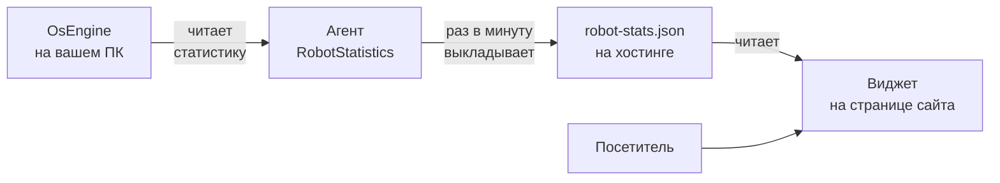

# Как показать статистику робота OsEngine на своём сайте

> [!info] Для кого
> У вас на компьютере (или на VPS) работает **OsEngine**, в нём торгует робот. Вы хотите, чтобы **сделки, прибыль, просадка и график доходности** этого робота сами появлялись на вашем сайте и обновлялись раз в минуту.

> [!warning] Статус
> Это инструкция к **готовому продукту** RobotStatistics. Сейчас готовы шаги 1–2 (они работают в любом OsEngine уже сегодня). Агент и виджет (шаги 3–6) — в разработке по [[ТЗ — Трансляция статистики робота]].

---

## Как это работает — в двух словах



1. **OsEngine** уже умеет отдавать статистику по своему внутреннему API (его нужно только включить).
2. **Агент** — маленькая программа рядом с OsEngine. Раз в минуту забирает данные выбранного робота и **выкладывает файл** на ваш хостинг.
3. **Виджет** — две строчки кода, которые вы вставляете на страницу сайта. Он читает файл и рисует карточки, график и таблицу сделок.

Ваш компьютер **ни к кому не подключается снаружи**: порты открывать не нужно, роутер не трогаем. Агент только сам отправляет файл наружу.

---

## Что понадобится

- [ ] OsEngine с запущенным роботом.
- [ ] Сайт, на страницу которого можно вставить HTML-код (Tilda, WordPress, свой сайт — подойдёт любой).
- [ ] Место, куда агент будет выкладывать файл. Подходит любое из:
  - **хостинг вашего сайта** с доступом по FTP/SFTP (почти любой платный хостинг);
  - **GitHub Pages** — бесплатно, если у сайта нет своего хостинга (Tilda, конструкторы);
  - **свой сервер** с приёмником — для продвинутых, см. [[#Вариант для своего сервера]].
- [ ] 15–20 минут.

---

## Шаг 1. Включить API в OsEngine

1. Запустите OsEngine. В главном окне (там, где выбирают «Тестер», «Терминал» и т. д.) нажмите кнопку **API**.
2. Откроется окно **MCP API**:
   - поставьте галочку **«Включить API»**;
   - **Порт** оставьте `6500`;
   - в поле **API Key** сотрите стандартный ключ `osengine-mcp-default-key` и впишите свой длинный (например, 32 случайных символа). Запишите его — понадобится агенту.
3. Нажмите **«Сохранить»**, затем **«Перезапустить»**.

> [!danger] Не публикуйте ключ API
> Этим ключом можно не только читать статистику, но и **открывать и закрывать сделки**, удалять роботов. Никогда не вставляйте его в код сайта, не отправляйте в чаты, не выкладывайте на GitHub. Агент держит ключ только у вас на компьютере.

> [!note] Вкладка «Allowed IPs» — не трогайте
> Агент работает на этом же компьютере, внешние адреса добавлять не нужно.

---

## Шаг 2. Проверить, что OsEngine отдаёт статистику

Откройте **PowerShell** и вставьте (замените `ВАШ_КЛЮЧ`):

```powershell
$key = "ВАШ_КЛЮЧ"
$url = "http://localhost:6500/api/v2/mcp"
$h = @{ "X-Api-Key" = $key; "Accept" = "application/json, text/event-stream" }

# 1. Открыть сессию
$init = '{"jsonrpc":"2.0","method":"initialize","params":{"protocolVersion":"2025-06-18","capabilities":{},"clientInfo":{"name":"check","version":"1.0"}},"id":1}'
$r = Invoke-WebRequest $url -Method Post -Headers $h -ContentType "application/json" -Body $init -UseBasicParsing
$h["Mcp-Session-Id"] = $r.Headers["Mcp-Session-Id"]
Invoke-WebRequest $url -Method Post -Headers $h -ContentType "application/json" -Body '{"jsonrpc":"2.0","method":"notifications/initialized"}' -UseBasicParsing | Out-Null

# 2. Список роботов
$list = '{"jsonrpc":"2.0","method":"tools/call","params":{"name":"bot_get_list","arguments":{}},"id":2}'
(Invoke-RestMethod $url -Method Post -Headers $h -ContentType "application/json" -Body $list).result.content[0].text
```

В ответе — список ваших роботов. **Найдите имя нужного робота** (поле с именем, например `CandleMonster_1`) и запишите его.

Теперь статистика этого робота (замените `ИМЯ_РОБОТА`):

```powershell
$stat = '{"jsonrpc":"2.0","method":"tools/call","params":{"name":"bot_journal_get_statistics","arguments":{"bot_name":"ИМЯ_РОБОТА"}},"id":3}'
(Invoke-RestMethod $url -Method Post -Headers $h -ContentType "application/json" -Body $stat).result.content[0].text
```

Вы увидите прибыль, Profit Factor, Sharpe, просадку, число сделок. **Сверьте с окном «Журнал» робота в OsEngine** — цифры должны совпасть: их считает один и тот же код.

> [!failure]- Не работает? Частые причины
> | Что видно | Причина | Что делать |
> |---|---|---|
> | «Невозможно соединиться» | API не включён или OsEngine закрыт | Шаг 1, нажать «Перезапустить» |
> | Работает с `localhost`, не работает с `127.0.0.1` | OsEngine слушает именно имя `localhost` | Писать только `localhost` |
> | `401` | Неверный ключ | Скопировать ключ из окна MCP API ещё раз |
> | `Robot '...' not found` | Опечатка в имени робота | Взять имя из `bot_get_list` целиком |
> | Пустая статистика | У робота ещё нет сделок | Нормально, появится после первой сделки |

---

## Шаг 3. Подготовить место для файла статистики

Выберите **один** вариант.

### Вариант А — хостинг вашего сайта (FTP/SFTP)

1. В панели хостинга найдите доступ по FTP или SFTP: **адрес сервера, логин, пароль**.
2. Создайте на сайте папку, например `/robot-stats/`.
3. Проверка: файл, выложенный туда, должен открываться по адресу `https://ваш-сайт.ru/robot-stats/...`.

> [!tip] Лучше отдельный FTP-пользователь
> Если хостинг позволяет — создайте отдельного FTP-пользователя с доступом **только к папке `/robot-stats/`**. Тогда даже при утечке пароля сайт не пострадает.

### Вариант Б — GitHub Pages (бесплатно, для Tilda и конструкторов)

1. Создайте на GitHub **публичный** репозиторий, например `my-robot-stats`.
2. В репозитории: **Settings → Pages → Source: Deploy from a branch → `main` / root** → Save.
3. Через минуту по адресу `https://<ваш-логин>.github.io/my-robot-stats/` откроется пустая страница — значит, всё работает.
4. Создайте токен для агента: **Settings (профиля) → Developer settings → Fine-grained tokens → Generate new token**:
   - доступ **только к этому репозиторию**;
   - права: **Contents — Read and write**, остальное — нет.
5. Сохраните токен — он нужен агенту.

> [!note] Всё в этом репозитории видно всем
> Туда попадает только то же, что посетители и так увидят на сайте. Ключ OsEngine туда **не уходит никогда**.

---

## Шаг 4. Установить и настроить агента

1. Скачайте `RobotStatistics.Agent.exe` со страницы релизов: `https://github.com/si0683/robotstatistics/releases`.
2. Положите в отдельную папку, например `C:\RobotStatistics\`.
3. Рядом создайте файл `agent.json`:

```json
{
  "osengine": {
    "url": "http://localhost:6500/api/v2/mcp",
    "api_key": "ВАШ_КЛЮЧ_OSENGINE"
  },
  "bot_name": "ИМЯ_РОБОТА",
  "public_name": "Мой робот — MOEX",
  "publish": {
    "mode": "ftp",
    "ftp": {
      "host": "ftp.ваш-хостинг.ru",
      "user": "robotstats",
      "password": "ПАРОЛЬ_FTP",
      "folder": "/robot-stats/",
      "secure": true
    }
  },
  "interval_sec": 60,
  "privacy": {
    "show_money": true,
    "show_volume": false,
    "open_positions": "show"
  }
}
```

Для **GitHub Pages** вместо блока `ftp` — так:

```json
  "publish": {
    "mode": "github",
    "github": {
      "repo": "ваш-логин/my-robot-stats",
      "branch": "main",
      "token": "ТОКЕН_GITHUB"
    }
  },
```

Что значат настройки приватности:

| Настройка | Значения | Что делает |
|---|---|---|
| `show_money` | `true` / `false` | `false` — на сайте только проценты, без сумм в рублях |
| `show_volume` | `true` / `false` | Показывать ли объём позиций (лоты) |
| `open_positions` | `show` / `delay` / `hide` | Открытые позиции: сразу / после закрытия сделки / не показывать |

4. Проверка — откройте PowerShell в папке агента:

```powershell
.\RobotStatistics.Agent.exe --list
```

Покажет роботов в OsEngine — убедитесь, что имя в `bot_name` есть в списке.

```powershell
.\RobotStatistics.Agent.exe --once
```

Один раз соберёт статистику и выложит файл. Откройте в браузере:

- вариант А: `https://ваш-сайт.ru/robot-stats/robot-stats.json`
- вариант Б: `https://<ваш-логин>.github.io/my-robot-stats/robot-stats.json`

Видите текст с вашими цифрами — всё работает.

> [!info] Какие файлы выкладывает агент
> - `robot-stats.json` — итоги, статистика, графики доходности и просадки, открытые позиции, последние 50 сделок (обновляется каждую минуту);
> - `robot-deals.json` — **вся история сделок** (обновляется, только когда появилась новая сделка).
>
> Формат — в [[ТЗ — Трансляция статистики робота#5. Контракт данных — снимок]].

---

## Шаг 5. Вставить виджет на сайт

Код вставки (замените адрес файла на свой из шага 4):

```html
<div id="robot-stats"></div>
<script src="https://cdn.jsdelivr.net/gh/si0683/robotstatistics@1/widget/robot-stats-widget.js"
        data-target="robot-stats"
        data-src="https://ваш-сайт.ru/robot-stats/robot-stats.json"
        data-theme="auto"
        data-lang="ru"></script>
```

Куда вставлять:

| Сайт | Как |
|---|---|
| **Tilda** | Добавить блок → «Другое» → **T123 «HTML-код»** → вставить код → Опубликовать |
| **WordPress** | Редактор страницы → блок **«Произвольный HTML»** → вставить код → Обновить |
| **Свой сайт** | Вставить в нужное место страницы как есть |

Что покажет виджет:

1. Статус: 🟢 «робот в работе» или 🔴 «не на связи с 21:40».
2. Карточки: прибыль (₽ и %), сделок, % прибыльных, Profit Factor, макс. просадка, Sharpe.
3. График доходности и просадки.
4. Таблица статистики: «Все / Long / Short» — как в журнале OsEngine.
5. Открытые позиции.
6. История сделок с фильтром по датам и кнопкой «Скачать CSV».

Можно показать только часть, например одни карточки: `data-parts="cards,equity"`.

---

## Шаг 6. Чтобы работало само

```powershell
.\RobotStatistics.Agent.exe --install-autostart
```

Агент будет запускаться вместе с Windows и работать в фоне. Отключить: `--uninstall-autostart`.

> [!warning] Пока компьютер выключен — данные не обновляются
> На сайте останется последняя статистика с пометкой «не на связи с …». Никакой ошибки посетитель не увидит. Если нужна статистика круглосуточно — перенесите OsEngine на VPS (ниже).

---

## Если OsEngine работает на сервере (VPS)

Всё то же самое, только **на VPS**:

1. Зайдите на VPS по RDP.
2. Шаги 1–4 — там, где работает OsEngine.
3. Вместо автозапуска — служба Windows (работает даже без входа в систему):

```powershell
.\RobotStatistics.Agent.exe --install-service
```

- Порт `6500` в брандмауэре VPS **не открывайте** — агент рядом с OsEngine, наружу API не нужен.
- Статистика на сайте обновляется 24/7.
- Как настроить сам VPS и автозапуск OsEngine — `CONTEXT_VPS_VDS.md` в проекте OsEngine.

| | Домашний ПК | VPS |
|---|---|---|
| Куда ставить агента | рядом с OsEngine на ПК | рядом с OsEngine на VPS |
| Автозапуск | `--install-autostart` | `--install-service` |
| Открывать порты | нет | нет |
| Статистика 24/7 | только пока ПК включён | да |

---

## Вариант для своего сервера

Если у сайта есть свой сервер (VPS с nginx, Node/PHP) и хочется хранить историю в своей базе — агент может не выкладывать файл, а **отправлять данные POST-запросом** на ваш адрес:

```json
  "publish": {
    "mode": "http",
    "http": {
      "url": "https://ваш-сайт.ru/api/robot-stats/ingest",
      "token": "ТОКЕН_ВАШЕГО_САЙТА"
    }
  },
```

Готовый приёмник (Node.js и PHP, один файл) лежит в репозитории в папке `receiver/`. Виджет при этом тот же — указываете ему `data-src="https://ваш-сайт.ru/api/robot-stats/<имя>"`.

---

## Безопасность — коротко

- ✅ Ключ OsEngine хранится **только** в `agent.json` на вашем компьютере.
- ✅ Агент умеет вызывать **только чтение** статистики — открыть или закрыть сделку он не может технически.
- ✅ На сайт уходят только сделки и цифры. Номера счетов, портфели, ключи биржи — никогда.
- ✅ Порты на компьютере и VPS не открываются.
- ❌ Не выкладывайте `agent.json` в интернет и на GitHub.
- ❌ Не оставляйте стандартный ключ `osengine-mcp-default-key`.

---

## Частые вопросы

**Статистика на сайте не совпадает с журналом.**
Агент берёт цифры у самого OsEngine. Расхождение бывает из-за кэша: хостинг или браузер показывают старый файл. Обновите страницу через 1–2 минуты. Виджет сам добавляет к адресу файла метку времени, чтобы обходить кэш.

**Хочу несколько роботов.**
В `agent.json` укажите массив `"bots": ["Робот1", "Робот2"]`. Для каждого появится свой файл, а в виджете — `data-src` на нужный.

**Виджет пишет «не удалось загрузить данные».**
Откройте адрес из `data-src` в браузере. Если файл не открывается — проблема в шаге 3/4. Если открывается — на хостинге может быть запрет чтения файла с чужого сайта (CORS). Для варианта А добавьте в папку `/robot-stats/` файл `.htaccess` со строкой
`Header set Access-Control-Allow-Origin "*"`.
GitHub Pages это уже разрешает.

**Посетители смогут скопировать вход робота?**
Если не хотите — поставьте `"open_positions": "delay"`. Тогда сделка появится на сайте только после закрытия.

## Связанное

- [[ТЗ — Трансляция статистики робота]] — техническое задание
- Репозиторий: https://github.com/si0683/robotstatistics
