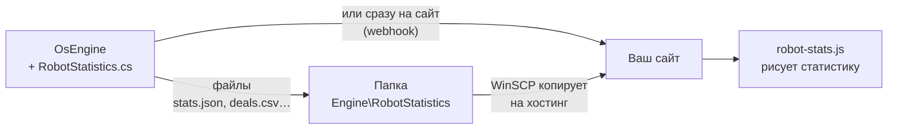
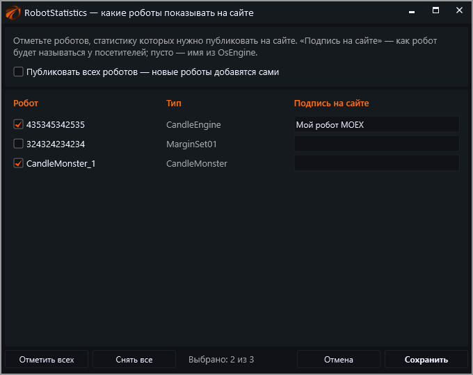

# Статистика робота OsEngine на своём сайте — инструкция для новичков

> [!TIP]
> **Как это выглядит:** https://si0683.github.io/robotstatistics/ — живая демо-страница: график, карточки, сделки, прогоны тестера.

## Что получится

На вашем сайте появится блок со статистикой робота, и он будет обновляться сам:

- прибыль, Profit Factor, просадка, Sharpe, процент прибыльных сделок;
- **график доходности** (TradingView Lightweight Charts) с отметкой каждой сделки и панелью просадки;
- таблица статистики «Все / Long / Short», как в журнале OsEngine;
- **открытые позиции** с текущим результатом;
- **все закрытые сделки**, скачивание в Excel (CSV) и RSS-лента;
- для тестера — **результат каждого прогона** и выбор между прогонами;
- **стоп и тейк** у каждой сделки и у открытых позиций, значок «стоп»/«тейк» у сделок, закрытых по ним, и счётчик «по стопу 22 · по тейку 10».

### Что именно берётся из OsEngine по каждой сделке

| Данные | Откуда в OsEngine |
|---|---|
| бумага, сторона, время и цена входа/выхода | `Position` |
| результат в %, в деньгах, в пунктах, комиссия | `ProfitOperationPercent`, `ProfitPortfolioAbs`, `ProfitOperationAbs`, `CommissionTotal()` |
| стоп и тейк | `StopOrderPrice`, `ProfitOrderPrice`. У открытой позиции это текущий уровень (с трейлингом), у закрытой — последний перед выходом |
| чем закрыта (стоп / тейк) | отдельного флага в OsEngine нет. Сначала берётся подпись сигнала закрытия: при срабатывании стопа OsEngine пишет туда сигнал стопа, если робот его задал. Иначе — цена закрытия в пределах 3 шагов цены (или 0,3 %) от уровня стопа/тейка |
| сигналы робота | `SignalTypeOpen`, `SignalTypeClose` |
| объём | `MaxVolume` / `OpenVolume` (по умолчанию скрыт) |

Не публикуются: номер счёта, портфель, комментарии к сделкам, параметры и код роботов.

## Как это работает



Вам понадобятся **два файла** из репозитория:

| Файл | Что это | Куда положить |
|---|---|---|
| `osengine/RobotStatistics.cs` | «робот», который собирает статистику. Сам он не торгует | в папку OsEngine `Custom\Robots\` |
| `site/robot-stats.js` | показывает статистику на странице | на хостинг вашего сайта |

Остальное в репозитории — примеры и документация.

---

## Шаг 0. Скачать файлы

1. Откройте https://github.com/si0683/robotstatistics.
2. Нажмите зелёную кнопку **Code** → **Download ZIP**.
3. Распакуйте архив, например, в `C:\RobotStatistics\`. Внутри будут папки `osengine`, `site`, `examples`.

---

## Шаг 1. Положить файл в OsEngine

### 1.1. Найти папку OsEngine

Нужна папка, **где лежит `OsEngine.exe`**. Обычно это:
- `C:\OsEngine\` — если ставили готовую сборку;
- `...\OsEngine\bin\Debug\` — если собирали из исходников.

> [!TIP]
> Не помните, где она? Нажмите правой кнопкой по ярлыку OsEngine на рабочем столе → **Расположение файла**.

### 1.2. Скопировать файл

1. В папке OsEngine откройте `Custom` → `Robots`. Там уже лежат `.cs`-файлы других роботов.
2. Скопируйте туда **`RobotStatistics.cs`** (из распакованной папки `osengine`).
3. Получится: `C:\OsEngine\Custom\Robots\RobotStatistics.cs`.
4. **Закройте и снова запустите OsEngine.** Файлы из этой папки OsEngine подхватывает только при запуске.

### 1.3. Добавить робота

1. Откройте режим, где торгуют роботы: **Роботы** (реальная торговля) или **Тестер** (проверка на истории).
2. Нажмите **«Добавить бота»**.
3. Вверху окна переключите фильтр на **«Скрипт»**, найдите в списке **RobotStatistics** и выберите его.
4. Введите любое имя, например `Статистика`, и нажмите **«Принять»**.

> [!NOTE]
> Если RobotStatistics нет в списке, проверьте, что файл лежит именно в `Custom\Robots` и OsEngine был перезапущен. Ошибки компиляции OsEngine показывает в логе.

### 1.4. Выбрать роботов

1. У робота «Статистика» нажмите **«Параметры»**.
2. На вкладке **«Основное»** нажмите **«Выбрать роботов…»**. Откроется окно:



3. Отметьте галочками роботов, которых нужно показывать на сайте. В колонке **«Подпись на сайте»** можно задать красивое название, например «Трендовый робот MOEX».
4. **«Публиковать всех роботов»** — показывать всех, включая роботов, которых вы добавите позже.
5. Нажмите **«Сохранить»**.

> [!TIP]
> Это же окно открывается из меню робота пунктом индивидуальных настроек.

### 1.5. Остальные параметры

Можно ничего не менять, всё уже работает. Если хочется настроить:

| Вкладка | Параметр | Что делает |
|---|---|---|
| Основное | Режим | `Выключено` — пауза |
| Основное | Обновлять каждые, сек | как часто обновлять файлы (по умолчанию 30) |
| Форматы | stats.json / deals.json / deals.csv / stats.csv / deals.rss | какие файлы делать (по умолчанию все) |
| Форматы | Разделитель CSV | `;` — открыть двойным щелчком в Excel; `,` — для Google Таблиц |
| Куда | Записывать файлы в папку | да — файлы в `Engine\RobotStatistics` |
| Куда | Папка | своя папка вместо стандартной |
| Куда | HTTP порт | для сервера: OsEngine сам отдаёт файлы по адресу (шаг 2В) |
| Куда | Отправлять на адрес (webhook) | сразу отправлять на сайт (шаг 2Б, Docker) |
| Куда | Ключ для webhook | пароль, который проверяет сайт |
| Тестер | Хранить прогонов | сколько последних прогонов тестера держать (20) |
| Приватность | Показывать суммы в деньгах | `нет` — на сайте только проценты, сумм нет даже в файлах |
| Приватность | Показывать объём позиций | лоты в сделках |
| Приватность | Открытые позиции | `Сразу` / `Только после закрытия` (не дать скопировать вход) / `Не показывать` |
| Приватность | Показывать стоп и тейк | уровни стопа и тейка у сделок и открытых позиций, значки «стоп»/«тейк», счётчик «по стопу · по тейку» |
| Приватность | Показывать сигналы робота | подписи сигналов входа и выхода (их видно при наведении на бумагу) |
| — | Обновить сейчас | обновить файлы, не дожидаясь таймера |

### 1.6. Проверить

Через 30 секунд откройте папку **`OsEngine\Engine\RobotStatistics\`**:

```
robots.json                  ← список роботов
moex-trend-1\                ← папка робота (имя латиницей)
    stats.json   ← итоги, статистика, графики, последние сделки
    deals.json   ← все сделки
    deals.csv    ← все сделки (открывается в Excel)
    stats.csv    ← статистика (открывается в Excel)
    deals.rss    ← лента сделок
tester\                      ← только если RobotStatistics добавлен в тестер
    runs.json                ← список прогонов
    runs\2026-11-09_15-30-12\...
```

Файлы есть — первая часть готова. Откройте `deals.csv` в Excel и проверьте, что сделки ваши.

---

## Шаг 2. Доставить данные на сайт

Сайт находится в интернете, а файлы лежат у вас на компьютере. Их нужно перенести. Выберите **один** вариант:

| Ваш случай | Вариант |
|---|---|
| Обычный сайт на хостинге, OsEngine на домашнем ПК | **2А** — WinSCP |
| Свой сервер с сайтом или сайт в Docker | **2Б** — отправка на адрес |
| OsEngine работает на VPS, сайт — где угодно | **2В** — HTTP из OsEngine + Caddy |
| Хотите один раз выложить готовый результат | **2Г** — вручную |

### 2А. Обычный хостинг + WinSCP (домашний ПК)

1. Установите бесплатный **WinSCP**: https://winscp.net.
2. В панели хостинга найдите доступ по **FTP** или **SFTP**: адрес сервера, логин, пароль.
3. В WinSCP: **Новое подключение** → протокол (SFTP или FTP) → адрес, логин, пароль → **Войти**.
4. Справа (это хостинг) откройте папку сайта (`public_html`, `www` или похожую) и создайте папку **`robot-stats`**.
5. Слева (это ваш компьютер) откройте `C:\OsEngine\Engine\RobotStatistics`.
6. Меню **Команды → Синхронизировать удалённую папку** (Keep remote directory up to date). Отметьте «Включая подпапки» и нажмите **Старт**.

Пока окно WinSCP открыто, новые файлы уходят на хостинг сами.

Проверка: откройте в браузере `https://ваш-сайт.ru/robot-stats/robots.json`. Если видите текст с именами роботов, всё работает.

> [!WARNING]
> Пока компьютер выключен (или закрыт WinSCP), сайт показывает последнюю статистику с пометкой «не на связи с …».

### 2Б. Отправка на адрес — свой сервер или Docker

RobotStatistics может сам отправлять данные на адрес вашего сайта (это называется webhook). Сайт принимает их и сохраняет. В репозитории есть готовый мини-сайт, который это умеет: `examples/docker-site`.

**Запустить его на своём компьютере в Docker:**

1. Установите **Docker Desktop**: https://www.docker.com/products/docker-desktop/ и запустите его.
2. Откройте папку `examples\docker-site` из распакованного архива.
3. Щёлкните по адресной строке Проводника, введите `cmd` и нажмите Enter. Откроется консоль в этой папке.
4. Введите команду:
   ```bash
   docker compose up -d
   ```
5. Откройте в браузере **http://localhost:3000**. Это ваш сайт, пока без данных.
6. В OsEngine у робота RobotStatistics: **Параметры → Куда → «Отправлять на адрес (webhook)»** =
   ```
   http://localhost:3000/api/robot-stats/ingest
   ```
7. Через 30 секунд обновите страницу, и статистика появится.

Данные сайта лежат в `examples\docker-site\data`. Остановить сайт: `docker compose down`.

> [!IMPORTANT]
> **Ключ.** Если сайт доступен из интернета, придумайте ключ. Откройте `docker-compose.yml`, уберите `#` в строке `INGEST_KEY: "…"` и впишите ключ. Тот же ключ укажите в OsEngine в «Ключ для webhook». Перезапустите: `docker compose up -d`.

**Свой сервер без Docker:** нужен Node.js 18+. Скопируйте `examples/docker-site` на сервер, положите рядом `robot-stats.js` в папку `lib`, запустите `node server.js`. Для постоянной работы используйте pm2 или systemd. Адрес для OsEngine: `https://ваш-сайт.ru/api/robot-stats/ingest`.

### 2В. OsEngine на VPS → HTTP прямо из OsEngine

1. В параметрах RobotStatistics: **HTTP порт** = `7000`.
2. Проверьте на самом сервере: `http://localhost:7000/robots.json`.
3. Сайт на `https://` может брать данные только по `https://`. Поставьте на VPS бесплатный **Caddy** (https://caddyserver.com):
   - у регистратора домена добавьте **A-запись**: имя `stats`, значение — IP вашего VPS;
   - рядом с `caddy.exe` создайте файл `Caddyfile` (без расширения):
     ```
     stats.ваш-домен.ru {
         reverse_proxy localhost:7000
     }
     ```
   - откройте в брандмауэре порты **80 и 443** и запустите `caddy.exe run`.
4. Проверьте с домашнего компьютера: `https://stats.ваш-домен.ru/robots.json`.

> [!CAUTION]
> Снаружи должны быть открыты **только 80 и 443**. Порт 7000 и порт API OsEngine **6500** держите закрытыми.

### 2Г. Один раз выложить результат

Скопируйте папку `Engine\RobotStatistics` на хостинг любым способом (FTP, файловый менеджер хостинга) и переходите к шагу 3. Обновлять файлы придётся вручную.

---

## Шаг 3. Вставить на сайт

### 3.1. Загрузить robot-stats.js

Загрузите `site/robot-stats.js` на хостинг в ту же папку `robot-stats`. Получится `https://ваш-сайт.ru/robot-stats/robot-stats.js`.

> [!NOTE]
> В варианте 2Б (Docker-сайт) это уже сделано: файл доступен по адресу `/lib/robot-stats.js`.

### 3.2. Вставить код

```html
<div id="robot-stats"></div>
<script src="/robot-stats/robot-stats.js"
        data-src="/robot-stats/robots.json"></script>
```

| Сайт | Куда вставить |
|---|---|
| **Tilda** | Добавить блок → «Другое» → **T123 «HTML-код»** → вставить → Опубликовать. У Tilda нет своего хостинга файлов, поэтому `robot-stats.js` и данные кладите на любой хостинг и указывайте полные адреса `https://…` |
| **WordPress** | Редактор страницы → блок **«Произвольный HTML»** → вставить → Обновить |
| **Свой HTML-сайт** | Вставить в нужное место страницы |

Что можно указать в `data-src`:
- `/robot-stats/robots.json` — все роботы, сверху выбор;
- `/robot-stats/moex-trend-1/stats.json` — один робот;
- `/robot-stats/tester/runs.json` — прогоны тестера, сверху выбор прогона;
- полный адрес, например `https://stats.ваш-домен.ru/robots.json` (вариант 2В).

Готово.

---

## Шаг 4 (по желанию). Своя вёрстка: график на главной, числа в тексте

Готовый виджет можно не вставлять, а собирать страницу из отдельных блоков. Подключите скрипт **один раз** и ставьте блоки куда угодно:

```html
<script src="/robot-stats/robot-stats.js" data-src="/robot-stats/robots.json"></script>

<!-- большой график на главной -->
<div data-rs="equity" data-robot="moex-trend-1" data-height="420" data-title=""></div>

<!-- карточки в шапке: только нужные показатели -->
<div data-rs="cards" data-robot="moex-trend-1" data-items="profit_percent,pf,drawdown"></div>

<!-- число прямо в тексте -->
<p>Profit Factor робота: <b><span data-rs="value" data-robot="moex-trend-1" data-field="pf"></span></b></p>

<!-- 5 последних сделок -->
<div data-rs="deals" data-robot="moex-trend-1" data-limit="5"></div>
```

`data-robot` — имя папки робота из `Engine\RobotStatistics` (например `moex-trend-1`).

### Блоки (`data-rs`)

| Блок | Что показывает | Свои настройки |
|---|---|---|
| `widget` | всё сразу (как в шаге 3) | `data-parts` |
| `status` | имя, «в работе / не на связи», выбор робота и прогона | — |
| `cards` | карточки показателей | `data-items` |
| `equity` | график доходности + просадка + отметки сделок | `data-height`, `data-unit`, `data-markers`, `data-drawdown`, `data-title`, `data-chart` |
| `stats` | таблица «Все / Long / Short» | — |
| `open` | открытые позиции | — |
| `deals` | сделки, CSV, RSS | `data-limit`, `data-links`, `data-all-button` |
| `value` | одно число в тексте | `data-field`, `data-format` |

### Показатели для `data-items` и `data-field`

`profit` (прибыль в деньгах), `profit_percent`, `deals`, `open`, `winrate` (% прибыльных), `pf` (Profit Factor), `drawdown`, `sharpe`, `recovery`, `payoff`, `commission`, `holding` (среднее время в сделке), `by_stop` (закрыто по стопу), `by_take` (закрыто по тейку).

В `data-field` можно указать и путь к любому полю `stats.json`, например `statistics.long.profit_factor`.

### Общие атрибуты

| Атрибут | Значения | По умолчанию |
|---|---|---|
| `data-src` | адрес `robots.json`, `stats.json` или `runs.json` | из `<script>` |
| `data-robot` | папка робота | первый в списке |
| `data-run` | id прогона тестера | последний |
| `data-theme` | `auto` / `light` / `dark` | `auto` (как у посетителя) |
| `data-currency` | `₽`, `USDT`, `$` … | `₽` |
| `data-refresh` | обновление, сек (`0` — выкл.) | `30` |
| `data-offline` | через сколько минут писать «не на связи» (`0` — не писать) | `5` |
| `data-height` | высота графика, px | `300` / `360` |
| `data-unit` | график в `abs` (деньги) или `percent` | деньги |
| `data-markers` | отметки сделок: `auto` / `on` / `off` | `auto` (до 300 сделок) |
| `data-chart` | `lwc` (TradingView) или `svg` (простой) | `lwc` |
| `data-parts` | для `widget`: `status,cards,equity,stats,open,deals` | все |
| `data-limit` | сколько последних сделок показать (остальные — кнопкой «Показать все», дальше по 50) | `10` |
| `data-frame` | рамка у `widget`: `on` / `off` | `on` |

### Цвета и шрифт под ваш сайт

Задайте CSS-переменные на странице. Виджет их подхватит:

```css
:root {
  --rs-font: "Inter", sans-serif;
  --rs-up: #16a34a;        /* прибыль */
  --rs-down: #dc2626;      /* убыток */
  --rs-accent: #2563eb;    /* ссылки, кнопки */
  --rs-bg: #ffffff;  --rs-card: #f6f7f9;  --rs-line: #e5e7eb;  --rs-text: #111827;  --rs-muted: #6b7280;
  --rs-radius: 16px;
  /* для тёмной темы: --rs-dark-bg, --rs-dark-up, --rs-dark-text … */
}
```

### Полностью свой код (React, Vue, Astro…)

```js
// данные
const data = await RobotStats.load("/robot-stats/moex-trend-1/stats.json");
console.log(data.statistics.all.profit_factor, data.open_positions, data.last_deals);

// только график в свой элемент
RobotStats.equityChart(document.querySelector("#chart"), data, { height: 500, unit: "percent" });

// любой блок из кода
RobotStats.mount(document.querySelector("#cards"), "cards", { src: "/robot-stats/robots.json", robot: "moex-trend-1" });

// следить за обновлениями
RobotStats.subscribe("/robot-stats/moex-trend-1/stats.json", 30, (d) => render(d));
```

Описание всех полей для TypeScript — в файле `site/robot-stats.d.ts`.

---

## Тестер: результат каждого прогона — на сайт

1. Откройте режим **Тестер**, добавьте своего робота и **RobotStatistics** (как в шаге 1.3).
2. В RobotStatistics нажмите **«Выбрать роботов…»** и отметьте нужных.
3. Для сайта в Docker (2Б) укажите адрес `http://localhost:3000/api/robot-stats/ingest`.
4. Запустите тест. После окончания в логе OsEngine появится строка `RobotStatistics: прогон тестера … опубликован`.
5. На сайте откройте вкладку **«Прогоны тестера»**. Новый прогон окажется первым в списке. Поменяйте параметры, запустите тест ещё раз и сравните прогоны.

Файлы прогонов лежат в `Engine\RobotStatistics\tester\runs\<дата-время>\`, список — в `tester\runs.json`. Хранятся последние 20 прогонов (параметр «Тестер: хранить прогонов»).

> [!NOTE]
> Оптимизатор RobotStatistics не трогает: там тысячи прогонов, и для них в OsEngine есть свои отчёты.

---

## Бонус: Excel, Google Таблицы, RSS

- **Excel:** откройте `deals.csv` двойным щелчком (при разделителе `;`).
- **Google Таблицы** (разделитель `,`): в ячейку A1
  `=IMPORTDATA("https://ваш-сайт.ru/robot-stats/moex-trend-1/deals.csv")`
- **RSS:** `https://ваш-сайт.ru/robot-stats/moex-trend-1/deals.rss` — в RSS-читалку или бота «RSS → Telegram». Каждая закрытая сделка приходит как новая запись.

---

## Если что-то не работает

| Что видно | Почему | Что делать |
|---|---|---|
| Нет RobotStatistics в списке «Добавить бота» | файл не в той папке или OsEngine не перезапущен | `Custom\Robots\RobotStatistics.cs`, перезапуск, фильтр «Скрипт» |
| Папка `Engine\RobotStatistics` пустая | Режим выключен или роботы не выбраны | «Режим = Включено», «Выбрать роботов…», «Обновить сейчас» |
| В тестере ничего не появилось | роботы не выбраны в окне выбора | в логе будет подсказка `…выбранных роботов нет…` |
| Виджет: «Не удалось загрузить статистику» | неверный `data-src` | откройте адрес из `data-src` в браузере, он должен показывать текст |
| То же, сайт на `https://`, данные на `http://` | браузер блокирует смешанное содержимое | HTTPS для данных (Caddy, шаг 2В) или те же папки на хостинге |
| То же, данные на другом домене | запрет CORS на хостинге | в папку `robot-stats` на хостинге положите `.htaccess` со строкой `Header set Access-Control-Allow-Origin "*"` |
| Лог: `webhook … недоступен` | сайт выключен или неверный адрес | `docker compose up -d`, проверьте адрес |
| Лог: `webhook … ответил 401` | ключи не совпадают | одинаковый ключ в `docker-compose.yml` и в OsEngine |
| Лог: `HTTP на порту … не запущен` | порт занят или нет прав | другой порт; для доступа снаружи — `netsh http add urlacl url=http://+:7000/ user=Все` от администратора |
| Нет карточки «Прибыль, %» | OsEngine не знает размер депозита вкладки | прибыль в деньгах и % на сделку показываются всё равно |
| Статистика не совпадает с журналом | кэш браузера или хостинга | подождите минуту, обновите страницу |

---

## Безопасность

- RobotStatistics **только читает** журналы. Открыть или закрыть сделку через него невозможно.
- На сайт уходят только сделки и цифры. Номера счетов, ключи биржи и настройки роботов не уходят никогда.
- Скрытые суммы и объёмы отсутствуют в самих файлах, а не просто спрятаны на странице.
- Не открывайте наружу порт API OsEngine (6500). Он даёт полный доступ к торговле.

## Связанное

- [[ТЗ — Трансляция статистики робота]]
- Демо: https://si0683.github.io/robotstatistics/
- Репозиторий: https://github.com/si0683/robotstatistics
