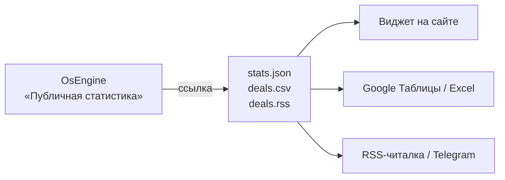

# Как показать статистику робота OsEngine на своём сайте

> [!info] Для кого
> В OsEngine торгует робот. Вы хотите, чтобы **сделки, прибыль, просадка и график доходности** сами появлялись на вашем сайте, в таблице или в RSS-ленте.

> [!warning] Статус
> Инструкция описывает **готовый продукт**. Модуль «Публичная статистика» в OsEngine и виджет пока в разработке: [[ТЗ — Трансляция статистики робота]].

---

## Как это работает



OsEngine сам публикует статистику выбранных роботов по ссылкам. Сайт, таблица или RSS-читалка просто открывают ссылку. Цифры считает сам OsEngine, поэтому они совпадают с окном «Журнал».

**Какой у вас случай:**

| OsEngine работает… | Что делать |
|---|---|
| **на сервере (VPS)** | [[#Часть 1. OsEngine на сервере]] — основной вариант, данные круглосуточно |
| **на домашнем компьютере** | [[#Часть 2. OsEngine на домашнем компьютере]] |
| нужно один раз выложить результат | [[#Часть 3. Разовый отчёт]] |

---

## Часть 1. OsEngine на сервере

### Шаг 1. Включить публичную статистику

1. Подключитесь к VPS по RDP и откройте OsEngine.
2. В главном окне нажмите **API** → в окне MCP API нажмите **«Публичная статистика»**.
3. Поставьте галочку **«Включить публичную статистику»**. Порт оставьте `7000`, «Слушать» — **«Только этот компьютер»**.
4. В таблице роботов отметьте нужного и заполните:
   - **Публичное имя** — так робот будет называться на сайте, например `CandleMonster — MOEX`;
   - **Адрес** — латиницей, без пробелов, например `candlemonster-moex`.
5. Настройте, что скрывать:
   - **Показывать суммы в деньгах** — снимите, если хотите показывать только проценты;
   - **Открытые позиции** — «Только после закрытия», если не хотите, чтобы копировали вход.
6. **Сохранить** → **Перезапустить**.

> [!tip] Робот без галочки не виден
> Даже если кто-то угадает его имя, лента ответит «не найдено». Номера счетов, ключи и настройки роботов в ленту не попадают никогда.

### Шаг 2. Проверить на сервере

Нажмите в окне **«Открыть в браузере»** или откройте на VPS:

- `http://localhost:7000/public/robots.json` — список опубликованных роботов;
- `http://localhost:7000/public/candlemonster-moex/stats.json` — статистика робота.

Если видите текст с цифрами, всё работает. Сверьте прибыль и число сделок с журналом робота.

> [!note] Терминал роботов должен быть открыт
> Данные берутся из запущенных роботов. Если окно с роботами закрыто, лента отдаёт последний сохранённый снимок с пометкой `offline`.

### Шаг 3. Сделать адрес с HTTPS

Сайт с адресом `https://` не может загружать данные с `http://`, браузер это блокирует. Поэтому нужен адрес вида `https://stats.ваш-домен.ru`. Проще всего сделать его через бесплатный **Caddy**: он сам получает и продлевает сертификат.

1. **Домен.** В панели, где куплен домен, добавьте запись:
   - тип **A**, имя `stats`, значение — **IP вашего VPS**.
   Подождите 10–30 минут.
2. **Caddy.** Скачайте `caddy_windows_amd64.exe` с caddyserver.com/download, положите в `C:\Caddy\` и переименуйте в `caddy.exe`.
3. Рядом создайте файл `Caddyfile` (без расширения):
   ```
   stats.ваш-домен.ru {
       reverse_proxy localhost:7000
   }
   ```
4. **Брандмауэр.** PowerShell от администратора:
   ```powershell
   New-NetFirewallRule -DisplayName "Caddy HTTP"  -Direction Inbound -Protocol TCP -LocalPort 80  -Action Allow
   New-NetFirewallRule -DisplayName "Caddy HTTPS" -Direction Inbound -Protocol TCP -LocalPort 443 -Action Allow
   ```
5. **Запуск** (в той же папке):
   ```powershell
   .\caddy.exe run
   ```
   Через минуту откройте у себя дома `https://stats.ваш-домен.ru/public/robots.json`. Видите данные — всё готово.
6. **Автозапуск Caddy**: зарегистрировать службой через NSSM (`nssm install Caddy C:\Caddy\caddy.exe run`) или добавить задачу в Планировщик заданий «При запуске системы».

> [!danger] Порты 7000 и 6500 наружу не открывайте
> Снаружи открыты только 80 и 443 (Caddy). Сам OsEngine слушает только `localhost`. Особенно важно держать закрытым **6500** — это API управления OsEngine.

> [!example]- Без домена, только проверить
> «Слушать» → **«Все адреса»**, затем один раз в PowerShell от администратора:
> ```powershell
> netsh http add urlacl url=http://+:7000/ user=Все
> New-NetFirewallRule -DisplayName "OsEngine PublicFeed" -Direction Inbound -Protocol TCP -LocalPort 7000 -Action Allow
> ```
> На английской Windows — `user=Everyone`. Ссылка `http://IP-сервера:7000/public/robots.json` заработает в браузере и в Google Таблицах, но **виджет на `https://`-сайте её не загрузит**. Для сайта нужен шаг 3.

### Шаг 4. Вставить на сайт

```html
<div id="robot-stats"></div>
<script src="https://cdn.jsdelivr.net/gh/si0683/robotstatistics@1/widget/robot-stats-widget.js"
        data-target="robot-stats"
        data-src="https://stats.ваш-домен.ru/public/candlemonster-moex/stats.json"></script>
```

| Сайт | Куда вставить |
|---|---|
| **Tilda** | Добавить блок → «Другое» → **T123 «HTML-код»** → Опубликовать |
| **WordPress** | Блок **«Произвольный HTML»** → Обновить |
| **Свой сайт** | В нужное место страницы как есть |

Виджет покажет: статус робота, карточки (прибыль, сделки, % прибыльных, Profit Factor, просадка, Sharpe), график доходности и просадки, таблицу статистики «Все / Long / Short», открытые позиции и историю сделок с кнопкой «Скачать CSV».

Показать только часть: `data-parts="cards,equity"`. Тема: `data-theme="dark"`.

### Шаг 5 (по желанию). Таблицы и RSS

**Google Таблицы** — сделки обновляются сами, в ячейку A1:
```
=IMPORTDATA("https://stats.ваш-домен.ru/public/candlemonster-moex/deals.csv")
```

**Excel** — Данные → Из Интернета → адрес `…/deals.csv?sep=semicolon`.

**RSS** — `https://stats.ваш-домен.ru/public/candlemonster-moex/deals.rss`. Каждая закрытая сделка — новая запись. Подходит для RSS-читалок и ботов, которые пересылают RSS в Telegram-канал.

**Все адреса робота:**

| Адрес | Что |
|---|---|
| `/public/robots.json` | список роботов |
| `/public/<адрес>/stats.json` | итоги, статистика, графики, последние сделки |
| `/public/<адрес>/deals.json` | все сделки |
| `/public/<адрес>/deals.csv` | все сделки таблицей |
| `/public/<адрес>/stats.csv` | статистика таблицей |
| `/public/<адрес>/deals.rss` | лента сделок |

---

## Часть 2. OsEngine на домашнем компьютере

Домашний компьютер стоит за роутером, и сайт из интернета до него не достучится. Поэтому OsEngine **пишет файлы в папку**, а маленький загрузчик выкладывает их на хостинг.

1. В окне «Публичная статистика» сделайте всё как в шаге 1 Части 1 и дополнительно включите **«Записывать файлы в папку»**. Файлы появятся в `OsEngine\Engine\PublicFeed\<адрес>\`.
2. Подготовьте место на хостинге:
   - **хостинг сайта** — FTP/SFTP-доступ и папка `/robot-stats/`, лучше отдельный FTP-пользователь только к ней;
   - **или GitHub Pages** (бесплатно, подходит для Tilda): публичный репозиторий → Settings → Pages → `main` → Save; токен **Fine-grained** только на этот репозиторий с правом **Contents: Read and write**.
3. Скачайте `RobotStatistics.Uploader.exe` из https://github.com/si0683/robotstatistics/releases, рядом создайте `uploader.json`:
   ```json
   {
     "folder": "C:\\OsEngine\\Engine\\PublicFeed",
     "mode": "ftp",
     "ftp": { "host": "ftp.ваш-хостинг.ru", "user": "robotstats", "password": "ПАРОЛЬ", "remote": "/robot-stats/", "secure": true }
   }
   ```
   для GitHub Pages вместо `ftp`:
   ```json
     "mode": "github",
     "github": { "repo": "логин/my-robot-stats", "branch": "main", "token": "ТОКЕН" }
   ```
4. Проверка: `.\RobotStatistics.Uploader.exe --once`, затем откройте `https://ваш-сайт.ru/robot-stats/candlemonster-moex/stats.json`.
5. Автозапуск: `.\RobotStatistics.Uploader.exe --install-autostart`.
6. В виджете `data-src` укажите адрес файла на хостинге.

> [!tip] Без нашей утилиты
> Подойдёт любая программа синхронизации папки: WinSCP (Команды → «Синхронизировать удалённую папку»), rclone, FTP-клиент с синхронизацией.

> [!warning] Пока компьютер выключен
> На сайте останется последний снимок с пометкой «не на связи с …». Чтобы данные шли круглосуточно, перенесите OsEngine на VPS (Часть 1).

---

## Часть 3. Разовый отчёт

Нужно просто выложить результат торговли, без постоянного обновления:

1. «Публичная статистика» → выберите робота → **«Сохранить отчёт…»** → укажите папку.
2. Загрузите получившиеся файлы на хостинг (или в GitHub Pages).
3. Вставьте виджет, в `data-src` — адрес `stats.json` на хостинге.

Включать публичную статистику и открывать порты для этого не нужно.

---

## Частые вопросы

**Цифры на сайте не совпадают с журналом.**
Лента обновляется раз в 30 секунд, хостинг и браузер могут кэшировать ещё 15 секунд. Подождите минуту. Если расхождение осталось — это ошибка, напишите в Issues репозитория.

**Виджет пишет «не удалось загрузить данные».**
Откройте адрес из `data-src` прямо в браузере.
- Не открывается — проблема в шагах 2–3 (Часть 1) или в загрузке (Часть 2).
- Открывается, но адрес начинается с `http://` — нужен HTTPS (шаг 3).
- Открывается по `https://` — добавьте домен сайта в «Разрешённые сайты» в окне «Публичная статистика» (или оставьте `*`). Для файлов на своём хостинге положите в папку `/robot-stats/` файл `.htaccess` со строкой `Header set Access-Control-Allow-Origin "*"`.

**Несколько роботов.**
Отметьте галочками всех. У каждого свой адрес, на сайте — свой виджет с нужным `data-src`.

**Безопасно ли это?**
Лента только читает журналы: открыть или закрыть сделку через неё невозможно. Публикуются только отмеченные роботы и только разрешённые поля. API управления OsEngine (порт 6500) остаётся закрытым.

**После перезагрузки VPS статистика пропала.**
Значит, не запустился OsEngine или Caddy. Настройте автозапуск обоих (`CONTEXT_VPS_VDS.md` в проекте OsEngine, шаг 3.6 выше).

## Связанное

- [[ТЗ — Трансляция статистики робота]]
- Репозиторий: https://github.com/si0683/robotstatistics
