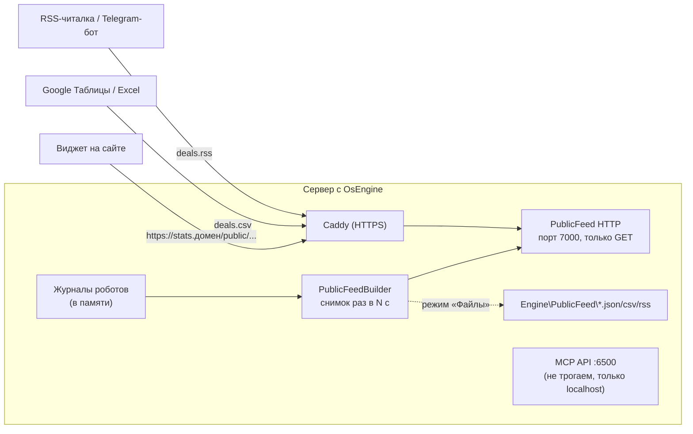
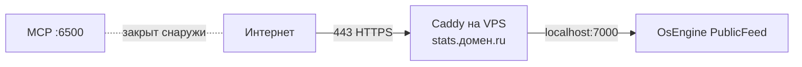

# ТЗ — Публичная статистика робота OsEngine

> [!abstract] Задача одной фразой
> **Сам OsEngine** публикует статистику выбранных роботов — итоги, статистику, кривую доходности, просадку и все сделки — по ссылкам в форматах **JSON, CSV и RSS**. Сайт просто забирает данные по ссылке и показывает их красиво. Без ручных выгрузок и без отдельных программ.

> [!note] Что изменилось в v2
> В v1 основным путём был отдельный агент, который читает MCP API. Это неудобно: лишняя программа, ключ управления на диске, настройка FTP. В v2 основной путь — **модуль «Публичная статистика» внутри OsEngine**. Агент остался только для домашнего ПК, где сайт не может достучаться до компьютера (раздел 6.2).

---

## 1. Что уже есть в OsEngine (результат скана)

Проект: `D:\4DevelopmentOS\OsEngine-master\project`

| Что | Где | Как используем |
|---|---|---|
| Сделки робота в памяти | `OsTraderMaster.Master.PanelsArray` → `BotPanel.GetJournals()` → `JournalClass.OpenPositions` / `CloseAllPositions` | Источник данных ленты (так же берёт данные MCP) |
| Сделки на диске | `Engine\<Робот><Вкладка>DealController.txt` (`OsEngine/Journal/Internal/PositionController.cs`) | **Не используем**: внутренний формат |
| Формулы статистики | `OsEngine/Journal/Internal/DealStatisticGenerator.cs`, класс `PositionStatisticGenerator` | Вызываем напрямую, поэтому цифры = окно «Журнал» |
| Расчёт equity/просадки | `OsEngine/MCP/Modules/RobotsApi.cs`: `GetJournalEquity`, `GetJournalDrawdown` (накопление `profit × MultToJournal / 100`) | Повторяем 1:1, сверяем тестом |
| HTTP-сервер | `OsEngine/MCP/McpMaster.cs`: `HttpListener`, сначала `http://*:порт/`, при отказе — `http://localhost:порт/` | Тот же подход, но **отдельный listener и порт** |
| Хост | `MainWindow.xaml.cs` создаёт `McpMaster` при старте | Там же создаётся `PublicFeedMaster` |
| Выгрузка из журнала вручную | Журнал → таблица сделок → правый клик → «Сохранить в файл» (`.txt`, `;`, 19 колонок, заголовки на языке интерфейса) | Только как запасной вариант |

> [!warning] Почему не открыть наружу MCP API
> Ключ MCP (`X-Api-Key`) даёт **полный доступ**: открыть или закрыть позицию, удалить робота, остановить терминал. Работает по HTTP без шифрования. Публиковать его в интернет нельзя. Поэтому лента — **отдельный модуль только для чтения на отдельном порту**, и MCP он никак не затрагивает.

---

## 2. Решение — модуль «Публичная статистика» (PublicFeed)



### 2.1. Где в коде

Новая папка `OsEngine/PublicFeed/`, ядро и роботы не меняются:

| Файл | Назначение |
|---|---|
| `PublicFeedMaster.cs` | Запуск и остановка `HttpListener`, маршрутизация GET, кэш, лимиты, таймер записи файлов |
| `PublicFeedBuilder.cs` | Сборка снимка робота из журналов: итоги, статистика All/Long/Short, equity, просадка, сделки |
| `PublicFeedFormats.cs` | Сериализация снимка в JSON, CSV и RSS |
| `PublicFeedSettings.cs` | Настройки, файл `Engine\PublicFeedSettings.txt` (по образцу `McpSettings`) |
| `PublicFeedUi.xaml(.cs)` | Окно настроек |
| `OsEngine/Language/PublicFeedLocal.cs` | Тексты окна Ru/Eng (`OsLocalization.ConvertToLocString`) |

Точки подключения (минимальные правки существующих файлов):

- `MainWindow.xaml.cs` — создать `PublicFeedMaster` рядом с `McpMaster`, запустить, если включено; остановить при выходе.
- `MCP/McpApiUi.xaml(.cs)` — кнопка **«Публичная статистика»**, открывает `PublicFeedUi`. Отдельной кнопки в главном окне не делаем, чтобы не менять его разметку.
- `OsLocalization.cs` — подключить `PublicFeedLocal`.

Логику MCP (`RobotsApi.cs`) **не трогаем**. Расчёт equity/просадки повторяем в `PublicFeedBuilder`, совпадение с `bot_journal_get_equity` / `bot_journal_get_drawdown` проверяем тестом (раздел 8).

### 2.2. Окно настроек

| Поле | По умолчанию | Описание |
|---|---|---|
| Включить публичную статистику | выкл | Главный выключатель |
| Порт | `7000` | Отдельный от MCP |
| Слушать | `Только этот компьютер` / `Все адреса` | «Все» нужен для доступа снаружи; без прав администратора — подсказка с командой `netsh` (раздел 4.2) |
| Записывать файлы в папку | выкл | Режим «Файлы»: снимки пишутся в `Engine\PublicFeed\` (раздел 6.2) |
| Обновлять каждые | `30` с | Частота сборки снимка |
| Таблица роботов | — | Список `PanelsArray`: галочка «публиковать», **публичное имя**, **адрес (slug)** латиницей (`candlemonster-moex`) |
| Показывать суммы в деньгах | да | Нет — только проценты |
| Показывать объём позиций | нет | — |
| Открытые позиции | `Сразу` | `Сразу` / `Только после закрытия` / `Не показывать` |
| Разрешённые сайты (CORS) | `*` | Список доменов через запятую |
| Ключ доступа | пусто | Если задан, лента отдаётся только с `?key=…`. Нужен, когда данные забирает сервер сайта, а не браузер посетителя |
| Кнопки | — | «Открыть в браузере» (`robots.json`), «Сохранить», «Перезапустить» |

Робот без галочки **не существует** для ленты: 404, даже если угадать его имя.

### 2.3. Адреса

Только `GET` (и `HEAD`); остальное — `405`.

| Адрес | Формат | Содержимое |
|---|---|---|
| `/public/robots.json` | JSON | Опубликованные роботы: slug, публичное имя, статус, прибыль %, число сделок |
| `/public/<slug>/stats.json` | JSON | Полный снимок (2.4) без истории сделок, плюс последние 50 сделок |
| `/public/<slug>/deals.json` | JSON | Все закрытые сделки; `?from=2026-01-01&to=…` |
| `/public/<slug>/deals.csv` | CSV | Все закрытые сделки; `?sep=semicolon` для Excel с русской локалью |
| `/public/<slug>/stats.csv` | CSV | Таблица статистики: показатель, Все, Long, Short |
| `/public/<slug>/deals.rss` | RSS 2.0 | Последние 100 закрытых сделок, новые сверху |
| `/public/health` | JSON | `{"ok":true,"terminal":"online"}` — для мониторинга |

### 2.4. Формат `stats.json`

```json
{
  "schema": 1,
  "slug": "candlemonster-moex",
  "public_name": "CandleMonster — MOEX",
  "generated_at": "2026-11-08T21:40:15+03:00",
  "status": { "terminal": "online", "last_trade_time": "2026-11-08T18:45:00+03:00" },
  "summary": {
    "net_profit": 12450.5, "net_profit_percent": 8.31,
    "period_from": "2026-03-01", "period_to": "2026-11-08", "deals_count": 214
  },
  "statistics": {
    "all":   { "net_profit": 12450.5, "net_profit_percent": 8.31, "deals_count": 214, "profitable_deals": 98, "losing_deals": 116, "profit_factor": 1.42, "sharpe": 0.91, "recovery": 2.1, "max_drawdown_percent": -4.8, "average_holding_time": "1д 3ч", "commission": 812.4 },
    "long":  { "…": "те же поля" },
    "short": { "…": "те же поля" }
  },
  "equity":   [ { "time": "2026-03-02T10:15:00+03:00", "value": 0.4 } ],
  "drawdown": [ { "time": "2026-03-02T10:15:00+03:00", "value": 0 } ],
  "open_positions": [
    { "number": 215, "security": "SBER", "direction": "Long", "open_time": "…", "entry_price": 301.2, "profit_percent": 0.4 }
  ],
  "last_deals": [
    { "number": 214, "security": "GAZP", "direction": "Short", "open_time": "…", "close_time": "…", "entry_price": 132.1, "close_price": 130.8, "profit_abs": 650, "profit_percent": 0.98, "commission": 4.1 }
  ]
}
```

- Поля статистики — те же, что у MCP `bot_journal_get_statistics`, значения из `PositionStatisticGenerator`.
- Время — ISO 8601 **со смещением пояса** (на VPS часто UTC).
- Если суммы скрыты, поля `net_profit`, `profit_abs`, `commission`, `entry_price`, `close_price` **не выводятся вовсе** (не обнуляются).
- Сделки со статусом `OpeningFail` и служебные (`PositionStatisticGenerator.IsServiceDeal`) не публикуются.
- `schema` — версия формата; новые поля только добавляются.

### 2.5. Формат `deals.csv`

- UTF-8 с BOM, RFC 4180, разделитель `,`, дробная часть через точку. С `?sep=semicolon` — разделитель `;`, дробная часть через запятую (Excel с русской локалью открывает двойным щелчком).
- Заголовки **всегда латиницей**, не зависят от языка OsEngine:
  `number,security,direction,open_time,close_time,entry_price,close_price,volume,profit_abs,profit_percent,commission`
- Скрытые поля исключаются из колонок.
- Google Таблицы: `=IMPORTDATA("https://stats.домен/public/<slug>/deals.csv")`.

### 2.6. Формат `deals.rss`

- RSS 2.0, `channel/title` = публичное имя, `link` = адрес страницы робота (поле настроек, необязательное).
- Один `item` = одна закрытая сделка:
  - `title`: `GAZP Short +0,98 %` (или `+650 ₽`, если суммы показываются);
  - `description`: вход → выход, цены, длительность;
  - `guid` (`isPermaLink="false"`): `<slug>-<number>`, чтобы читалки и боты не дублировали сделку;
  - `pubDate`: время закрытия (RFC 822).
- Подходит для RSS-читалок и Telegram-ботов вида «RSS → канал».

### 2.7. Работа сервера

- Снимок собирается **по таймеру** в фоновом потоке, а не на каждый запрос. Запросы получают готовый кэш, поэтому нагрузка на торговый поток не зависит от числа посетителей.
- Списки позиций меняются торговым потоком, поэтому перед расчётом копируем их (`ToArray()` в `try/catch`), при сбое отдаём прошлый снимок и пишем в лог.
- Заголовки: `Content-Type` с `charset=utf-8`, `Cache-Control: public, max-age=15`, `ETag` (304 на `If-None-Match`), `Access-Control-Allow-Origin` по настройке CORS.
- Лимит: 120 запросов в минуту с одного IP, сверх него — `429`.
- Терминал роботов не открыт (`OsTraderMaster.Master == null`): `robots.json` и `stats.json` отдают **последний сохранённый снимок** со `status.terminal = "offline"` и временем `generated_at`. Пока снимка нет — `503` с JSON-пояснением.
- Последний снимок каждого робота хранится в `Engine\PublicFeed\cache\`, поэтому после перезапуска OsEngine лента сразу отдаёт данные.
- Логи — в общий лог OsEngine (`LogMessageType.System` для старта и остановки, `Error` для сбоев), без записи каждого запроса.

### 2.8. Безопасность

- [ ] Модуль не вызывает никаких методов торговли и управления, а только читает журналы.
- [ ] Публикуются только отмеченные роботы; slug задаёт пользователь, внутренние имена ботов наружу не уходят.
- [ ] Наружу не уходят номера счетов, портфели, ключи, настройки и параметры роботов.
- [ ] Отдельный порт: MCP остаётся на `localhost`, открытие ленты его не открывает.
- [ ] По умолчанию выключено и слушает только `localhost`.
- [ ] Ответы ограничены по размеру (`deals.json` постранично: `?limit`, `?offset`, по умолчанию 5000).

---

## 3. Сайт и виджет

Сайт пользователя может быть любым: Tilda, WordPress, свой. Сервер на стороне сайта не нужен.

### 3.1. Виджет `widget/robot-stats-widget.js` (в этом репозитории)

```html
<div id="robot-stats"></div>
<script src="https://cdn.jsdelivr.net/gh/si0683/robotstatistics@1/widget/robot-stats-widget.js"
        data-target="robot-stats"
        data-src="https://stats.example.ru/public/candlemonster-moex/stats.json"></script>
```

- Один JS-файл без зависимостей; стили изолированы в Shadow DOM, поэтому тема Tilda или WordPress на него не влияет.
- Атрибуты: `data-src`, `data-theme` (`auto`/`light`/`dark`), `data-lang` (`ru`/`en`), `data-parts` (`status,cards,equity,drawdown,stats,open,deals`).
- Блоки: статус (🟢 в работе / 🔴 не на связи с …), карточки, график доходности и просадки, таблица статистики All/Long/Short, открытые позиции, история сделок (`deals.json` загружается при открытии) с фильтром и кнопкой CSV.
- Опрос раз в 30 с, учитывает `ETag`.
- Работает и с файлами, выложенными на хостинг (режим «Файлы», 6.2): формат тот же.

### 3.2. Свой сервер сайта (необязательно)

Если сайт хочет хранить данные у себя, его сервер забирает `stats.json` / `deals.json` по расписанию (с ключом доступа, 2.2) и отдаёт своим страницам. Пример — `examples/server-fetch/` (Node и PHP, по одному файлу).

---

## 4. Развёртывание на сервере (основной случай)

### 4.1. Схема



### 4.2. Шаги на VPS

1. Включить модуль, отметить роботов, задать slug.
2. Проверить на самом VPS: `http://localhost:7000/public/robots.json`.
3. HTTPS (обязательно, иначе сайт на `https://` не сможет загрузить данные: браузер блокирует смешанное содержимое):
   - DNS: A-запись `stats.домен.ru` → IP VPS;
   - установить Caddy for Windows, `Caddyfile`:
     ```
     stats.домен.ru {
         reverse_proxy localhost:7000
     }
     ```
   - Caddy сам получает и продлевает сертификат Let's Encrypt;
   - брандмауэр: открыть входящие **80 и 443** (80 нужен для выпуска сертификата).
   - В этом варианте PublicFeed слушает **только `localhost`**: права администратора и `netsh` не нужны, порт 7000 наружу закрыт.
4. Без домена (для проверки): режим «Все адреса», один раз от администратора
   `netsh http add urlacl url=http://+:7000/ user=Все` (на английской Windows `user=Everyone`), открыть входящий 7000. Работает только с `http://`-страницами и из Google Таблиц, **не** из виджета на `https://`-сайте.
5. Порт MCP `6500` в брандмауэре должен оставаться закрытым (`McpMaster` при запуске от администратора слушает все адреса).
6. Автозапуск OsEngine после перезагрузки VPS — по `CONTEXT_VPS_VDS.md`.

---

## 5. Сравнение вариантов

| | **PublicFeed в OsEngine** (v2) | Агент через MCP (v1) | Ручная выгрузка из журнала |
|---|---|---|---|
| Доп. программы | нет (Caddy — для HTTPS) | агент + FTP/GitHub | нет |
| Обновление | само, 30 с | само, 60 с | вручную |
| Ключ управления на диске | не нужен | нужен | не нужен |
| Статистика = журнал | да | да | считать на сайте |
| CSV / RSS | да | нет | только txt |
| Домашний ПК за NAT | только с режимом «Файлы» + загрузка | да | да |
| Минус | правка OsEngine, переносить при обновлениях | лишняя программа | муторно |

---

## 6. Особые случаи

### 6.1. Сайт на том же сервере

Сайт обращается к `http://localhost:7000/...` со своего сервера, либо включается режим «Файлы» с папкой внутри сайта. HTTPS и открытые порты для ленты не нужны.

### 6.2. OsEngine на домашнем ПК

До домашнего компьютера снаружи не достучаться (NAT, нет белого IP), поэтому сайт не может забрать ленту сам.

- В PublicFeed включается **«Записывать файлы в папку»**: каждые N секунд OsEngine пишет `stats.json`, `deals.json`, `deals.csv`, `deals.rss` в `Engine\PublicFeed\<slug>\` (атомарно: временный файл → переименование).
- Отправку на хостинг делает **загрузчик** — маленькая утилита из этого репозитория (`uploader/`), которая следит за папкой и выкладывает изменившиеся файлы по FTP/SFTP или в репозиторий GitHub Pages. MCP и ключ OsEngine ей не нужны.
- Альтернатива без нашей утилиты — любой синхронизатор папки (rclone, WinSCP «синхронизация»).
- Пока ПК выключен, на сайте остаётся последний снимок со временем обновления.

### 6.3. Разовая публикация результата

Кнопка в окне PublicFeed **«Сохранить отчёт…»** — один раз записывает все файлы робота в выбранную папку. Эти файлы загружаются на хостинг вручную, а виджет показывает их так же, как живые данные.

---

## 7. Что НЕ входит

- Управление роботами через ленту — никогда.
- Публикация параметров и кода роботов.
- Сверка с брокером: берём то, что видит журнал OsEngine.
- Личные кабинеты и закрытые страницы для посетителей.

---

## 8. Этапы

| # | Этап | Результат | Проверка |
|---|---|---|---|
| 1 | `PublicFeedBuilder` + JSON | снимок робота | Статистика, equity, просадка **совпадают** с MCP `bot_journal_get_statistics/equity/drawdown` на том же роботе |
| 2 | `PublicFeedMaster` + `/public/*.json` | HTTP на localhost | Нагрузка 50 запросов/с не влияет на торговлю; кэш, ETag, 404 для неопубликованных |
| 3 | Окно настроек + локализация | галочки, slug, приватность | Скрытые поля отсутствуют в ответе |
| 4 | CSV и RSS | `deals.csv`, `stats.csv`, `deals.rss` | Открывается в Excel (`;`) и Google Таблицах (`IMPORTDATA`); RSS проходит W3C Feed Validator |
| 5 | Офлайн-снимок и режим «Файлы» | `Engine\PublicFeed\` | Терминал закрыт → `offline` + последний снимок |
| 6 | Виджет | `widget/` | Работает в Tilda (T123), WordPress, на обычной странице; светлая и тёмная тема; 360 px |
| 7 | VPS + Caddy | инструкция проверена | Сайт на `https://` показывает виджет с VPS |
| 8 | Загрузчик для домашнего ПК | `uploader/` | Файлы на хостинге обновляются; пропал интернет → досылка |
| 9 | Документация OsEngine | `CONTEXT_PUBLIC_FEED.md`, строка в `CONTEXT.md` | По правилам `AGENTS.md` |

После каждого этапа в OsEngine: `dotnet build OsEngine/OsEngine.csproj`. MCP-стенд запускаем только с разрешения: модуль MCP не меняется, но кнопка в `McpApiUi` — общий файл.

---

## 9. Критерии приёмки

- [ ] Отметил робота галочкой, и по ссылке появились его итоги, статистика, графики и все сделки.
- [ ] Цифры совпадают с окном «Журнал» OsEngine.
- [ ] Новая закрытая сделка появляется в JSON/CSV/RSS не позже чем через 60 с.
- [ ] Неотмеченные роботы и скрытые поля недоступны никаким запросом.
- [ ] MCP API не стал доступен снаружи, а лента не умеет ничего, кроме чтения.
- [ ] С закрытым терминалом лента отдаёт последний снимок и статус `offline`, а не ошибку.
- [ ] Виджет на `https://`-сайте работает с лентой на VPS через Caddy.
- [ ] Домашний ПК: режим «Файлы» + загрузчик держат статистику на хостинге актуальной.

---

## 10. Открытые вопросы

1. Предлагать модуль в официальный OsEngine (pull request в `AlexWan/OsEngine`)? Тогда он будет у всех и не придётся переносить его при обновлениях. Значит, код по `CONTEXT_CODING_GUIDELINES.md` и тексты Ru/Eng.
2. Порт по умолчанию `7000` — устраивает?
3. Нужна ли общая лента «все роботы сразу» (`/public/all/...`)?
4. Equity по умолчанию в `%` от депозита (`DepositPercent`, как у MCP) или в деньгах?

---

## Связанное

- [[Инструкция — Статистика робота на своём сайте]] — инструкция для пользователя
- `CONTEXT_MCP_V2.md`, `CONTEXT_VPS_VDS.md`, `CONTEXT_CODING_GUIDELINES.md` — в проекте OsEngine
- `OsEngine/MCP/McpMaster.cs` — образец HTTP-сервера
- `OsEngine/MCP/Modules/RobotsApi.cs` — образец чтения журналов (`GetPositions`, `GetJournalEquity`)
- `OsEngine/Journal/Internal/DealStatisticGenerator.cs` — формулы статистики
