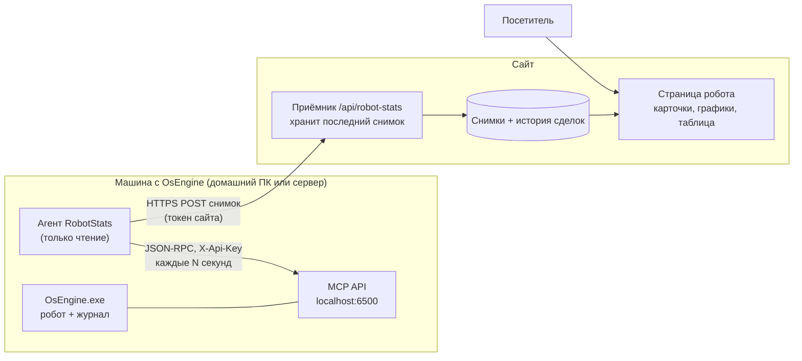
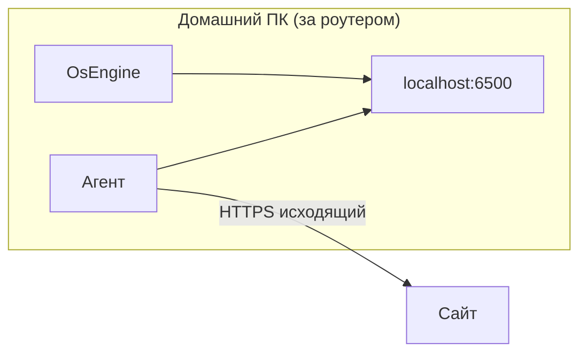
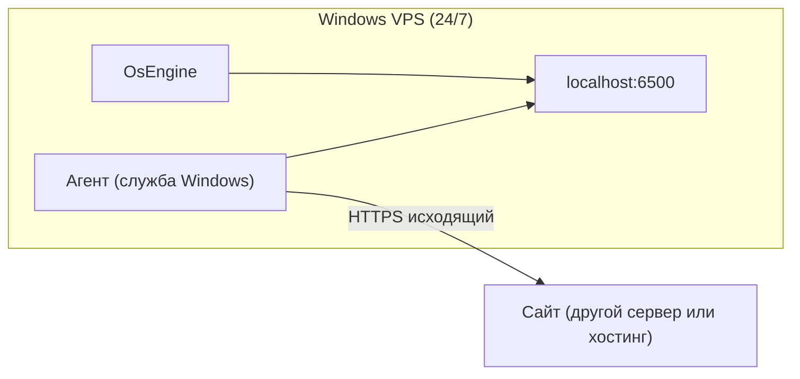

# ТЗ — Трансляция статистики робота OsEngine на сайт

> [!abstract] Задача одной фразой
> Выбрать **одного робота** в запущенном OsEngine (на домашнем ПК или на сервере), забирать с него **всю историю сделок, итоговую статистику, кривую доходности и просадку** и **показывать это на моём сайте** — автоматически, без ручных выгрузок.

---

## 1. Что уже есть в OsEngine (результат скана проекта)

Проект: `D:\4DevelopmentOS\OsEngine-master\project`

> [!success] Главное открытие
> OsEngine **уже умеет отдавать всё нужное** через встроенный MCP API (V2). Ничего в самом OsEngine и в роботах менять не нужно.

### 1.1. MCP API — встроенный HTTP-сервер

| Параметр | Значение | Где в коде |
|---|---|---|
| Адрес | `http://localhost:6500/api/v2/mcp` (Streamable HTTP, JSON-RPC 2.0) | `OsEngine/MCP/McpMaster.cs` |
| Порт | `6500` по умолчанию | `Engine\McpSettings.txt` |
| Ключ | заголовок `X-Api-Key` (по умолчанию `osengine-mcp-default-key`) | `OsEngine/MCP/McpSettings.cs` |
| Белый список IP | `AllowedIps` | `OsEngine/MCP/McpAllowedIp.cs` |
| Привязка | пытается `http://*:6500/`, если нет прав администратора — только `localhost` | `McpMaster.cs`, метод `Start` |
| Протокол | **HTTP без шифрования** | — |

Документация: `CONTEXT_MCP_V2.md`.

### 1.2. Нужные методы (все — только чтение)

| Метод | Что отдаёт | Параметры |
|---|---|---|
| `bot_get_list` | Список роботов (для выбора) | — |
| `bot_journal_get_summary` | Итог: прибыль, период, число сделок | `bot_name` |
| `bot_journal_get_statistics` | Таблица статистики (см. ниже) | `bot_name`, `side` = `All` / `Long` / `Short` |
| `bot_journal_get_equity` | Кривая доходности | `bot_name`, `chart_type` = `Absolute` / `Percent1Contract` / `DepositPercent` |
| `bot_journal_get_drawdown` | Кривая просадки | `bot_name` |
| `bot_journal_get_volume` | Объёмы и плечо по бумагам | `bot_name` |
| `bot_journal_get_open_positions` | Открытые позиции | `bot_name`, `limit`, `offset` |
| `bot_journal_get_closed_positions` | Закрытые сделки (вся история) | `bot_name`, `include_failed`, `limit`, `offset` |
| `bot_get_data_freshness` | Свежесть данных робота (жив ли поток) | `bot_name` |
| `terminal_get_status` | Состояние терминала | — |

Код: `OsEngine/MCP/Modules/RobotsApi.cs`.

**Статистика** (`bot_journal_get_statistics`) считается тем же кодом, что и окно «Журнал» OsEngine (`OsEngine/Journal/Internal/DealStatisticGenerator.cs`, класс `PositionStatisticGenerator`), поэтому цифры на сайте **совпадут с журналом один в один**:

`net_profit`, `net_profit_percent`, `deals_count`, `average_holding_time`, `sharpe`, `profit_factor`, `recovery`, `profitable_deals`, `losing_deals`, `max_drawdown_percent`, `commission`.

**Одна сделка** (`PositionToDto`):

`number`, `bot_name`, `security_name`, `direction` (Long/Short), `state`, `open_time`, `close_time`, `entry_price`, `close_price`, `volume`, `open_volume`, `profit_abs`, `profit_percent`, `commission`.

### 1.3. Где сделки лежат на диске (запасной источник)

- Файл `Engine\<ИмяРобота><ИмяВкладки>DealController.txt` — первая строка тип комиссии, вторая — размер, дальше по строке на позицию (`Position.GetStringForSave()`).
- Код: `OsEngine/Journal/Internal/PositionController.cs` (`Load`, `SavePositions`).
- Формат внутренний, не документирован, меняется вместе с OsEngine → **читать файл напрямую — только запасной вариант** (если терминал выключен).

> [!warning] Важно про ключ MCP
> Ключ `X-Api-Key` даёт **полный доступ**: тем же ключом можно открыть/закрыть позицию (`bot_position_open_at_market`, `bot_position_close_at_market`), удалить робота (`bot_delete`), остановить терминал. Поэтому **сайт и браузер посетителя никогда не ходят в OsEngine напрямую** — только через агента с белым списком методов (раздел 3).

---

## 2. Общая схема



**Принцип:** агент **сам отправляет** данные на сайт (push). На машине с OsEngine **не нужно открывать порты**, белый IP и роутер не настраиваются — работает и дома за NAT, и на VPS одинаково.

---

## 3. Компонент 1 — Агент RobotStats

Небольшая программа, которая живёт **рядом с OsEngine** (на той же машине).

### 3.1. Что делает

1. Читает свой конфиг (`agent.json`).
2. Подключается к MCP: `initialize` → получает `Mcp-Session-Id`.
3. По расписанию вызывает **только разрешённые методы** (белый список — раздел 1.2) для выбранного `bot_name`.
4. Собирает из ответов **один снимок** (раздел 5).
5. Публикует снимок одним из способов (`publish.mode`):

| Режим | Куда | Для кого | Что выкладывает |
|---|---|---|---|
| `ftp` | FTP/SFTP хостинга сайта | любой сайт с хостингом | файлы `robot-stats.json` + `robot-deals.json` |
| `github` | репозиторий с GitHub Pages (Contents API, fine-grained токен на один репозиторий) | Tilda, конструкторы, нет хостинга | те же файлы |
| `http` | `POST https://<сайт>/api/robot-stats/ingest`, `Authorization: Bearer <токен>` | свой сервер | снимок с `closed_positions_delta` |

   - В файловых режимах (`ftp`, `github`) сайт ничего не копит → агент сам хранит **полную историю** сделок у себя (`history.json` рядом с exe) и выкладывает её целиком в `robot-deals.json`, только когда она изменилась. `robot-stats.json` — итоги, графики, открытые позиции, последние 50 сделок.
   - Запись атомарная: сначала временный файл, потом переименование — виджет не прочитает «половину» файла.
   - `github`: коммит только при изменении содержимого (не чаще раза в минуту), чтобы не раздувать историю репозитория.
6. Если место публикации недоступно — хранит последние снимки в очереди на диске и досылает.
7. Если OsEngine не отвечает — публикует «пульс» со статусом `offline` (виджет покажет «робот не на связи с …»).

### 3.1.1. Команды агента

| Команда | Что делает |
|---|---|
| `--list` | Список роботов из OsEngine (`bot_get_list`) |
| `--once` | Один сбор + одна публикация, затем выход (для проверки) |
| _(без аргументов)_ | Работа по расписанию |
| `--install-autostart` / `--uninstall-autostart` | Автозапуск при входе в Windows (домашний ПК) |
| `--install-service` / `--uninstall-service` | Служба Windows (VPS, работает без входа) |

### 3.2. Выбор робота

- В конфиге: `"bot_name": "CandleMonster_1"` (уникальное имя робота из OsEngine).
- Команда `agent --list` вызывает `bot_get_list` и печатает имена — чтобы не угадывать.
- Задел на будущее: массив `bots` — несколько роботов, по снимку на каждого.

### 3.3. Частота

| Данные | Как часто | Почему |
|---|---|---|
| Открытые позиции, статус, свежесть | 10–30 с | Меняется постоянно |
| Сводка, статистика, equity, просадка | 60 с | Меняется только при закрытии сделки |
| Закрытые сделки | только **новые** (по `number`, постранично `limit/offset`) | История может быть длинной |
| Полная пересверка истории | раз в сутки и при старте | Ловит правки/удаления в журнале |

### 3.4. Пример конфига `agent.json`

```json
{
  "osengine": {
    "url": "http://localhost:6500/api/v2/mcp",
    "api_key": "СВОЙ_КЛЮЧ_НЕ_ДЕФОЛТНЫЙ"
  },
  "bot_name": "CandleMonster_1",
  "public_name": "CandleMonster — MOEX",
  "publish": {
    "mode": "ftp",
    "ftp":    { "host": "ftp.example.ru", "user": "robotstats", "password": "…", "folder": "/robot-stats/", "secure": true },
    "github": { "repo": "login/my-robot-stats", "branch": "main", "token": "…" },
    "http":   { "url": "https://example.ru/api/robot-stats/ingest", "token": "…" }
  },
  "intervals_sec": { "fast": 15, "slow": 60, "full_resync_hours": 24 },
  "privacy": {
    "show_volume": false,
    "show_money": true,
    "open_positions": "show"
  }
}
```

`open_positions`: `show` — сразу; `delay` — сделка видна только после закрытия; `hide` — никогда. Используется только блок, указанный в `mode`. Пользовательская версия — [[Инструкция — Статистика робота на своём сайте]].

### 3.5. Технологии агента

- **.NET 10, консольное приложение** + режим службы Windows (`--install-service`) — тот же стек, что у OsEngine, легко запускать на Windows VPS.
- Один `.exe`, без установки зависимостей.
- Лог в файл рядом с exe, ротация 30 дней.

### 3.6. Жёсткие правила безопасности агента

- [ ] В коде **зашит белый список** методов из раздела 1.2. Любой другой метод агент вызвать не может (даже если в конфиг что-то дописали).
- [ ] Ключ MCP и токен сайта — только в `agent.json` на этой машине, в логах маскируются.
- [ ] Агент ходит в MCP **только на `localhost`**.
- [ ] Наружу отправляет только поля из раздела 5 (никаких номеров счетов, портфелей, ключей биржи).

---

## 4. Два режима развёртывания

### 4.1. Локально — OsEngine на домашнем ПК



- MCP включается в OsEngine (окно настроек MCP), **ключ меняем на свой**.
- Агент запускается рядом (автозагрузка Windows или служба).
- MCP остаётся на `localhost` — снаружи к ПК никто не подключается.
- **Ограничение:** ПК выключен / OsEngine закрыт → новых данных нет. Сайт показывает последний снимок и плашку «обновлено 8 ноября в 21:40, робот не на связи».

> [!tip] Для разработки
> Сайт можно поднять тоже локально (`http://localhost:4321`), агент шлёт туда же. Весь путь проверяется без интернета.

### 4.2. На сервере — OsEngine на Windows VPS



- То же самое, что локально: **агент ставится на VPS рядом с OsEngine** как служба Windows.
- Порт `6500` **наружу не открываем** (MCP без HTTPS, ключ даёт полный доступ). В брандмауэре VPS ничего не меняем.
- Данные идут круглосуточно, плашка «не на связи» — только при падении терминала/VPS.
- Настройка VPS, автозапуск OsEngine — по `CONTEXT_VPS_VDS.md`.

### 4.3. Сравнение

| | Локально | Сервер |
|---|---|---|
| Где агент | на ПК рядом с OsEngine | на VPS рядом с OsEngine |
| Открывать порты | нет | нет |
| Данные 24/7 | только пока ПК включён | да |
| Задержка на сайте | 15–60 с | 15–60 с |
| Отличие в настройке | автозагрузка | служба Windows |

> [!note] Вариант «сайт сам забирает данные» (pull) — отклонён
> Пришлось бы открыть MCP наружу (`AllowedIps`, права администратора на `http://*:6500/`) и гнать полный ключ управления по сети без HTTPS. Допустимо **только** через VPN-туннель (WireGuard/SSH) между сайтом и VPS. Для домашнего ПК за NAT не работает вообще. Push-схема проще и безопаснее в обоих режимах.

---

## 5. Контракт данных — снимок

Агент шлёт на сайт один JSON. Сайт ничего не пересчитывает — показывает как есть.

```json
{
  "schema": 1,
  "robot_id": "candlemonster-moex",
  "public_name": "CandleMonster — MOEX",
  "sent_at": "2026-11-08T21:40:15+03:00",
  "status": {
    "terminal": "online",
    "data_fresh": true,
    "last_data_time": "2026-11-08T21:40:00+03:00"
  },
  "summary": {
    "net_profit": 12450.5,
    "net_profit_percent": 8.31,
    "period_from": "2026-03-01",
    "period_to": "2026-11-08",
    "deals_count": 214
  },
  "statistics": {
    "all":   { "net_profit": 12450.5, "profit_factor": 1.42, "sharpe": 0.91, "recovery": 2.1, "max_drawdown_percent": -4.8, "profitable_deals": 98, "losing_deals": 116, "average_holding_time": "1д 3ч", "commission": 812.4 },
    "long":  { "...": "то же для Long" },
    "short": { "...": "то же для Short" }
  },
  "equity":   [ { "time": "2026-03-02T10:15:00", "value": 0 }, { "time": "...", "value": 12450.5 } ],
  "drawdown": [ { "time": "...", "value": -1.2 } ],
  "open_positions": [
    { "number": 215, "security_name": "SBER", "direction": "Long", "open_time": "...", "entry_price": 301.2, "profit_percent": 0.4 }
  ],
  "closed_positions_delta": [
    { "number": 214, "security_name": "GAZP", "direction": "Short", "open_time": "...", "close_time": "...", "entry_price": 132.1, "close_price": 130.8, "profit_abs": 650, "profit_percent": 0.98, "commission": 4.1 }
  ],
  "full_resync": false
}
```

Правила:

- `closed_positions_delta` — только новые сделки (сайт копит историю у себя). При `full_resync: true` — вся история целиком, сайт заменяет свою копию.
- Поля `volume`, денежные суммы — по флагам `privacy` (можно показывать только проценты).
- `schema` — версия контракта, сайт игнорирует неизвестные поля.

---

## 6. Компонент 2 — Виджет и приёмник

Сайт пользователя может быть любым (Tilda, WordPress, свой). Основной продукт — **виджет**, который читает JSON по адресу. Приёмник нужен только в режиме `http`.

### 6.0. Виджет `widget/robot-stats-widget.js`

- Один JS-файл без зависимостей (графики — встроенный SVG или Lightweight Charts, подгружаемый с CDN), раздача через jsDelivr из репозитория: `https://cdn.jsdelivr.net/gh/si0683/robotstatistics@1/widget/robot-stats-widget.js`.
- Атрибуты: `data-target` (id контейнера), `data-src` (адрес `robot-stats.json` или `GET` приёмника), `data-theme` (`auto`/`light`/`dark`), `data-lang` (`ru`/`en`), `data-parts` (`status,cards,equity,drawdown,stats,open,deals` — по умолчанию все).
- `robot-deals.json` берёт по тому же адресу, лениво — при открытии таблицы истории.
- Опрос раз в 30 с, к адресу добавляет `?t=<время>` против кэша хостинга.
- Стили изолированы (Shadow DOM), чтобы тема Tilda/WordPress не ломала вёрстку и наоборот.
- Адаптив до 360 px; ошибку загрузки показывает внятно («не удалось загрузить данные», ссылка на FAQ).
- Кнопка «Скачать CSV» — из уже загруженных сделок, без сервера.

### 6.1. Приёмник (режим `http`, папка `receiver/`)

Готовый однофайловый приёмник в двух вариантах — `receiver/node/` и `receiver/php/` (PHP — для обычного хостинга).


- `POST /api/robot-stats/ingest` — проверяет токен, валидирует JSON (zod/аналог), сохраняет:
  - последний снимок (перезапись);
  - закрытые сделки (дописывание по `number`, без дублей);
  - время последнего контакта.
- `GET /api/robot-stats/<robot_id>` — публичная отдача для страницы, кэш 15–30 с.
- Хранилище: SQLite (или БД сайта). Без БД на первом этапе — JSON-файл.

### 6.2. Страница робота `/robots/<robot_id>`

Сверху вниз:

1. **Шапка**: имя робота, статус (🟢 в работе / 🔴 не на связи с …), «обновлено N с назад».
2. **Карточки**: прибыль ₽ и %, число сделок, % прибыльных, Profit Factor, макс. просадка, Sharpe.
3. **График доходности** (equity) + переключатель ₽ / % ; под ним **просадка**.
4. **Таблица статистики** — как в журнале OsEngine, колонки «Все / Long / Short».
5. **Открытые позиции** (если есть).
6. **История сделок**: таблица с сортировкой, фильтр по периоду и направлению, постраничная загрузка, выгрузка CSV.

Обновление: опрос `GET` раз в 15–30 с (без WebSocket на первом этапе).

### 6.3. Встраивание

- Готовая страница на моём сайте **и** виджет `<script src=".../robot-stats-widget.js" data-robot="candlemonster-moex">` — чтобы вставить карточки/график в любую другую страницу.

> [!note] Решено 2026-11-08
> Продукт делаем **для любого сайта**, а не для конкретного: виджет + публикация файла (FTP / GitHub Pages) закрывают сайты без своего сервера; приёмник `receiver/` — для своего сервера.

---

## 7. Что НЕ входит

- Управление роботом с сайта (старт/стоп, сделки) — **никогда**, только просмотр.
- Изменения в коде OsEngine и роботов.
- Сверка с брокером (берём то, что видит журнал OsEngine).
- Регистрация посетителей и закрытые страницы — позже, если понадобится.

---

## 8. Этапы

| # | Этап | Результат | Проверка |
|---|---|---|---|
| 0 | Проверка MCP руками | `curl` на `bot_get_list`, `bot_journal_get_statistics` выбранного робота | Цифры = окно «Журнал» OsEngine |
| 1 | Агент: чтение | `agent --list`, `agent --once` печатает снимок в файл | JSON по разделу 5 |
| 2 | Агент: публикация `ftp` и `github` + очередь | файлы на хостинге / GitHub Pages | Выключил интернет на 10 мин → история без дыр |
| 3 | Виджет | карточки, графики, таблицы, CSV | Цифры = журнал OsEngine; работает в Tilda (T123) и WordPress |
| 4 | Приватность | флаги `privacy` | Скрытые поля не уходят даже в JSON |
| 5 | Локальный режим | `--install-autostart` | Перезагрузка ПК → данные пошли сами |
| 6 | Серверный режим | `--install-service` на VPS | Перезагрузка VPS → данные пошли сами |
| 7 | Режим `http` + `receiver/` (Node, PHP) | приёмник на своём сервере | Повторная отправка не дублирует сделки |
| 8 | Релиз | exe в GitHub Releases, виджет через jsDelivr `@1` | Прохожу [[Инструкция — Статистика робота на своём сайте]] с нуля на чистом ПК |

---

## 9. Критерии приёмки

- [ ] Выбираю робота по имени в конфиге — на сайте появляется именно он.
- [ ] Итоговая статистика на сайте **совпадает** с журналом OsEngine (прибыль, PF, просадка, число сделок).
- [ ] Вся история закрытых сделок на сайте, новая сделка появляется ≤ 60 с после закрытия.
- [ ] Одинаково работает с OsEngine на домашнем ПК и на VPS; порты наружу не открыты.
- [ ] OsEngine выключен → на сайте последний снимок + «не на связи с …», а не ошибка.
- [ ] Агент физически не может вызвать торговые/управляющие методы MCP.
- [ ] Ключ MCP и токен сайта не попадают в логи и в ответы сайта.

---

## 10. Открытые вопросы

1. ~~Какой сайт и стек?~~ — решено: любой сайт (раздел 6).
2. Показывать деньги (₽) или только проценты? Показывать объём позиций?
3. Открытые позиции — в реальном времени или с задержкой (чтобы не копировали вход)?
4. Один робот или сразу несколько (страница-список роботов)?
5. Нужна ли «доходность от депозита» (`DepositPercent`) — тогда в журнале робота должен быть задан депозит.

## Связанное

- `D:\4DevelopmentOS\OsEngine-master\project\CONTEXT_MCP_V2.md` — описание MCP API
- `D:\4DevelopmentOS\OsEngine-master\project\CONTEXT_VPS_VDS.md` — OsEngine на сервере
- `OsEngine/MCP/Modules/RobotsApi.cs` — методы `bot_journal_*`
- `OsEngine/Journal/Internal/DealStatisticGenerator.cs` — формулы статистики
- `OsEngine/Journal/Internal/PositionController.cs` — хранение сделок на диске
